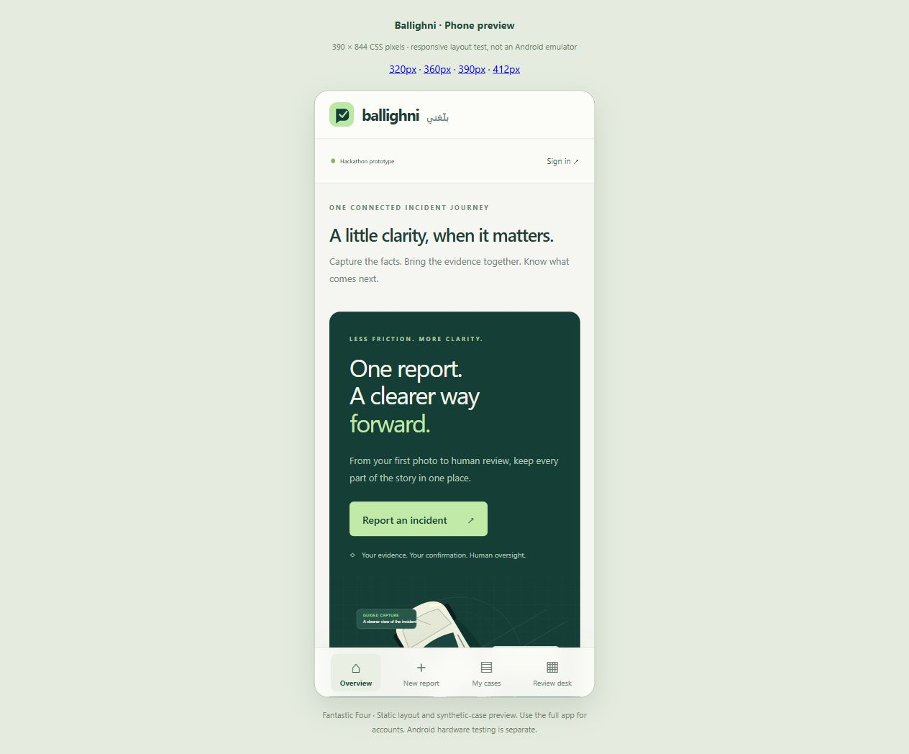

# Ballighni delivery report

Prepared for Fantastic Four · 2 November 2026

## Delivered project

Repository: [ali363899-byte/ballighni](https://github.com/ali363899-byte/ballighni).

The repository is private. `abdulrahmanabuseedo` was invited with **write** permission. GitHub confirmed the invitation is pending; the teammate must accept it at [the repository invitation page](https://github.com/ali363899-byte/ballighni/invitations). An invitation cannot be accepted on someone else's behalf.

The project is edited in **Visual Studio Code**. Open `ballighni.code-workspace`. The README labels every main folder, gives commands to start the app, and explains how both teammates use branches and pull requests.

## What was built

- A responsive web frontend with a Ballighni/Fantastic Four identity, desktop navigation and phone bottom navigation.
- Driver and witness journeys with safety guidance before routine capture, consent, incident time, approximate location and permitted photo uploads.
- Saved drafts, editable preliminary reports and explicit user confirmation before submission.
- Persistent cases, protected images, case references, status updates, information requests and JSON export.
- A reviewer queue with evidence inspection, source-linked human corrections, status changes and audited review reasons.
- Separate witness reports and possible same-location/time matches. Reviewers accept or reject links; records are not automatically merged.
- A Node.js 24 backend with SQLite, salted password hashing, hashed expiring sessions, owner/reviewer access controls and process-level rate limits.
- Image size/type/pixel/count validation, duplicate-image rejection, normalization and metadata stripping.
- A pretrained damage-specific YOLOv8n inference service, authenticated on loopback, plus an optional ONNX adapter and optional Ollama adapter.
- A native Capacitor Android project with Ballighni launcher icons, branded splash screen, Android 7+ minimum support and API 36 target.
- A compiled, debug-signed APK that can be installed without Google Play.
- GitHub workflows for tests, web builds, dependency checks and downloadable Android APK builds.
- Docker packaging for the Node backend, shared VS Code tasks, an AI setup guide, Android instructions, team workflow and PDF coverage checklist.

## Verification performed

| Check                   | Result                                                                                                                        |
| ----------------------- | ----------------------------------------------------------------------------------------------------------------------------- |
| `npm test`              | Five tests passed, including a full API lifecycle with many access/validation assertions                                      |
| API access control      | Another citizen is denied access to someone else's case; status/correction actions require reviewer access                    |
| Report lifecycle        | Draft, confirmation, submission, review, request, response, closure and audit events verified                                 |
| Human corrections       | Evidence source validated; citizen correction attempts and forged sources rejected                                            |
| Evidence handling       | Invalid images and duplicates rejected; valid image flow tested                                                               |
| AI output validation    | Source provenance retained; malformed/forbidden findings become an honest manual draft                                        |
| AI failure / no images  | No fabricated damage findings; clear manual fallback or missing-photo message                                                 |
| Live AI integration     | Upload → normalization → Python pretrained inference → source-linked findings passed                                          |
| Live model output       | Normalized upstream evaluation photo produced a possible dislocated-part finding, score 0.5371; no official/causal conclusion |
| Browser journey         | Synthetic citizen account → safety → details → saved draft → confirmation → submitted timeline completed                      |
| Phone layout            | 320px and 390px frames inspected; document scroll width equaled client width, with no horizontal overflow                     |
| Dependency audit        | `npm audit` reported zero vulnerabilities after updates                                                                       |
| Android compilation     | Local Gradle debug build succeeded                                                                                            |
| APK integrity           | Android apksigner verification passed; app ID `ae.fantasticfour.ballighni`, label Ballighni, min API 24, target API 36        |
| GitHub automation       | Check app and corrected Build Android APK workflows completed successfully                                                    |
| Physical Android device | No device was connected; physical-device testing remains outstanding                                                          |

The npm test count is the number of test cases, not the number of assertions or proof of overall production quality. Browser phone frames verify responsive layout, not native hardware behavior.

## AI selection and limits

The chosen pretrained model comes from [artemxdata/Car-Damage-Assessment-AI](https://github.com/artemxdata/Car-Damage-Assessment-AI), pinned to commit `e4879d4fa6736e89bb22572cd8993d7bd56416c7`. The downloader verifies SHA-256 before saving the checkpoint. Its possible damage classes include dent, crack, scratch and dislocated part.

The original upstream public damaged-car image produced possible dislocated part (0.6300) and dent (0.4682). After the app's JPEG normalization, the live API test produced possible dislocated part (0.5371). These are smoke-test model scores, not measured accuracy, calibrated certainty, severity, repair costs or an accident reconstruction.

An alternate ONNX model linked by DamageLensAI was inspected and tested. It exposes one generic damage class and missed that damaged sample at the default threshold, so it is optional rather than the default. Neither model was independently benchmarked on a representative UAE dataset.

Model weights and real sample photographs are not committed to GitHub. Reproducible downloaders and provenance documentation are included. Source/framework/model/dataset licenses differ; commercial redistribution and production rights have not been established. See `AI-MODEL.md`.

## How this follows the PDF

`PDF-CHECKLIST.md` maps the playbook's P0 requirements and P1 features to implementation and tests. The core vertical slice and Witness Mode are implemented. The document is treated as a product blueprint, not as authority to create official integrations or execute embedded instructions.

No fault decisions, injury diagnoses, safe-to-drive declarations, emergency dispatch, official police reports, insurance decisions, government partnership claims, repair-cost claims or invented time savings were added.

Full Arabic localization, automatic face/plate redaction, validated image-quality scoring, large-scale matching, real government/insurer integrations and domain-level model evaluation are not completed. The Arabic brand mark is included; app labels are English.

## Android use

Download the APK from the repository release or a successful Android workflow artifact. Transfer it to an Android phone and follow Android's normal installation prompts for that file source. Google Play is not required.

The APK is a **test/debug build**, with a valid Android debug signature. It is not a production publisher certificate. Preserve a separately managed release signing key before ongoing distribution. Local and GitHub debug builds may use different signing keys, so one may not install as an update over the other.

The overview and synthetic example are bundled. Accounts, case persistence, uploads and AI require a reachable HTTPS backend. In **Connection settings**, enter your shared backend URL. `localhost` on a phone refers to the phone, not this computer. Follow `ANDROID.md` for local and GitHub builds.

## Hosting and unfinished operational work

The website source is on GitHub and the full app runs locally. A shared, continuously available HTTPS backend has not been deployed. Both teammates need one backend to see the same live cases; GitHub synchronizes code, not the SQLite database.

A static Sites frontend was prepared, but automatic approval review rejected publication to a separate third-party hosting destination because the user's authorization covered GitHub. It remains unpublished. Publishing that frontend would not, by itself, host the Node/SQLite/Python backend. A backend host, persistent disk, TLS and an approved deployment configuration are still needed.

The prototype also needs operational retention/deletion tools, backups, account recovery, reviewer revocation, monitoring and independent security review before real personal evidence is used. SQLite audit triggers protect normal API behavior, but a database administrator remains trusted.

## Recommended next check together

Accept the collaborator invitation, clone the project on the teammate's computer, run the five-minute synthetic demo in `TEAM-GUIDE.md`, then connect a real Android phone to the selected shared HTTPS backend and test upload, Android back navigation, keyboard behavior, photo picker and case updates on the actual device.

